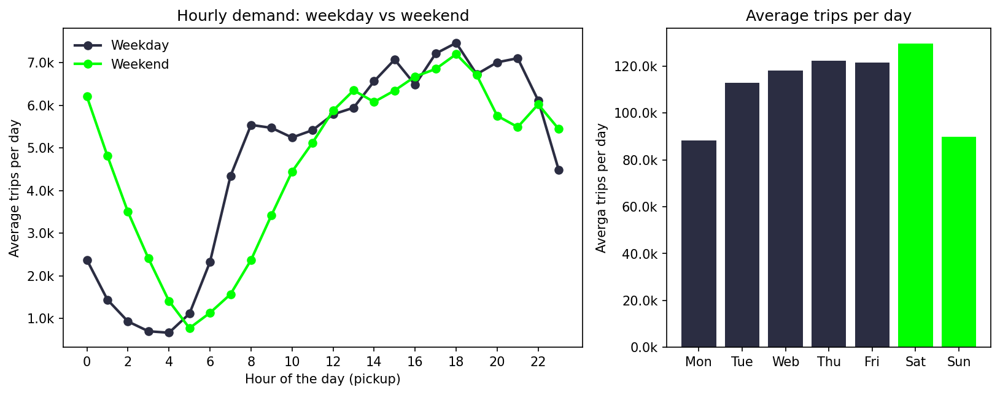
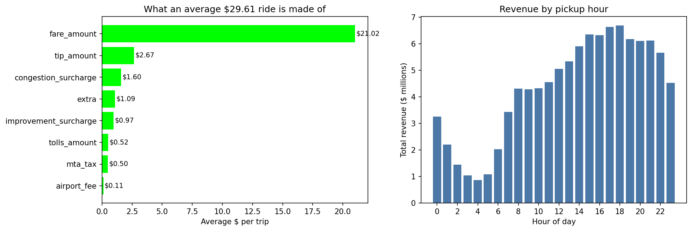
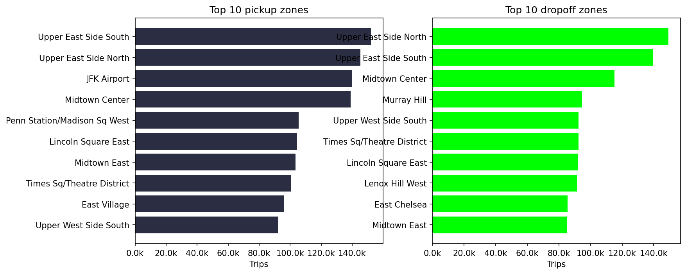

Juel Antonio Teixeira Baptista
October 14, 2026

# NYC Yellow Taxi — Data Analysis

Exploratory analysis of NYC yellow taxi trip data using Python
(pandas, matplotlib) in Google Colab. Data covers January 2026.

## Question

What patterns emerge in NYC taxi trips — when do they happen,
where, and what drives fare and tip amounts?

## Data

NYC TLC Yellow Taxi trip records ([3,724,889] trips, January 2026), plus the
taxi zone lookup table.
Source: https://www.nyc.gov/site/tlc/about/tlc-trip-record-data.page

## Approach

All analysis is in `NewYorkTaxiAnalysis.ipynb`:
1. **Load** — read the trip data into a pandas DataFrame
2. **Clean** — handle missing values, filter out-of-pattern behaviour, cast types
3. **Explore** — trip volume, fare distribution, day/week/hour patterns
4. **Visualize** — charts with matplotlib

## Key findings

1. **Hourly demand:** Weekdays have a sharp 8 AM peak, Weekends do not. Both peak at 6 PM.
2. **Weekly volume** Saturday is the busiest day.
3. **Trip length** Median trip is 1.9 miles and 14 minutes.
4. **Greography** Upper East Side South is the top pickup zone (4.3% of trips).
5. **Fare Breakdown** An average $29.61 ride is made mostly of base fare ($21.02) and tips($2.67)
6. **Payment Behaviour** Credit card dominates (62.4%) with a median tip of 27.4% of the fare for card trips that tipped.

## Charts
**Weekdays have an 8 AM rush that weekends lack, but both share a 6 PM evening peak. Saturday is the busiest single day.**

**An average $29.61 ride is driven by base fare ($21.02) and tips ($2.67). Total revenue peaks at 6 PM.**

**Upper East Side South dominates pickups, while drop-offs are more evenly spread across Midtown and the airport.**

## Skills

Python · pandas · data cleaning · exploratory analysis · matplotlib · Jupyter/Colab

## Running it

The notebook loads data from Google Drive. To run it yourself:
1. Download the trip data and zone lookup from the TLC link above
2. Place them in your Drive under `data/`
3. Open the notebook and run all cells

